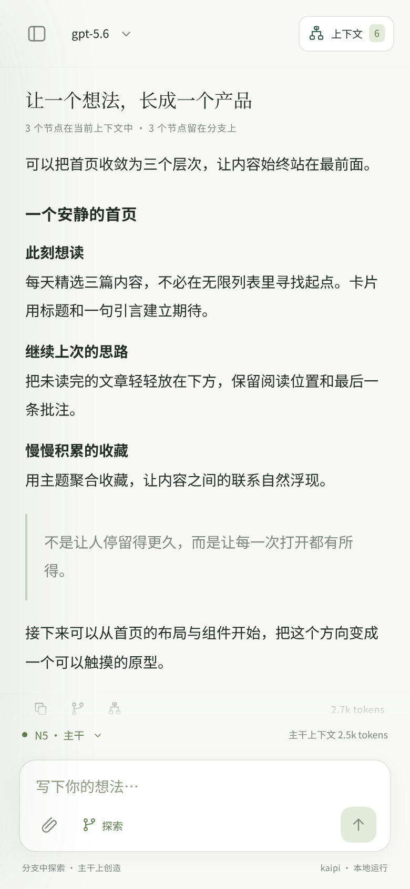
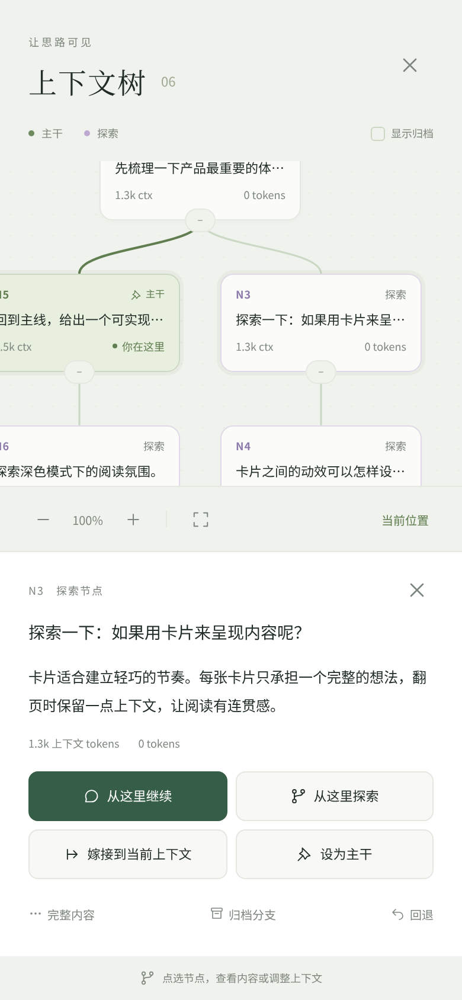
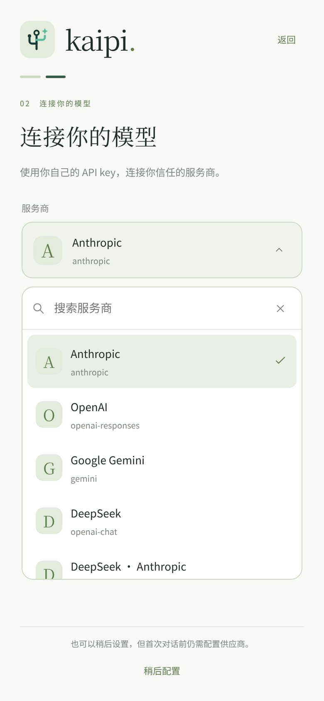
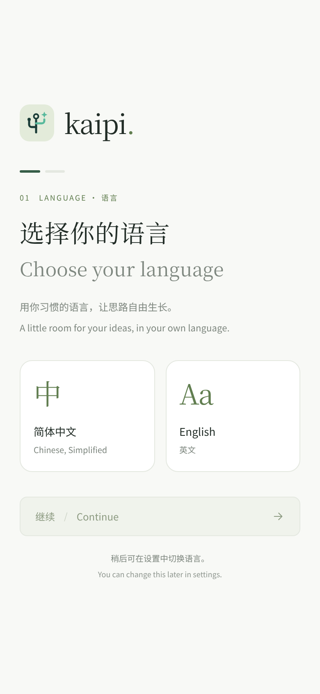
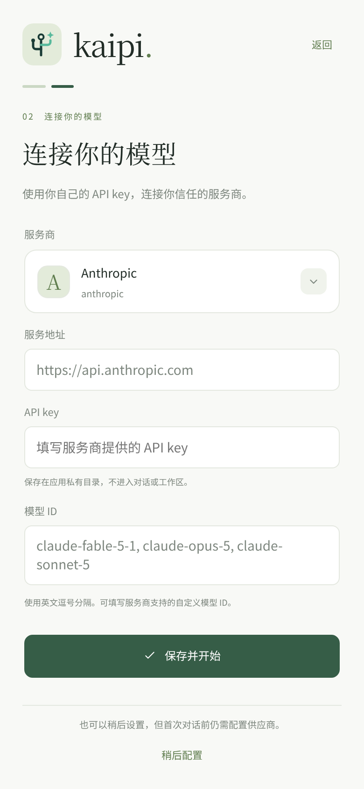
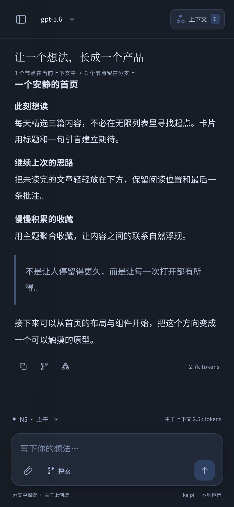

<h1 align="center">
  <picture>
    <source media="(prefers-color-scheme: dark)" srcset="docs/assets/kaipi-logo-dark.svg">
    
  </picture>
  &nbsp;kaipi for Android
</h1>

<strong>在手机上，让思路长成一棵树。</strong> A thoughtful Android home for kaipi.

  
  
  

<a href="#安装">下载安装</a> · <a href="#让上下文可见">树形上下文</a> · <a href="#为手机而设计">界面与体验</a> · <a href="docs/DEVELOPMENT.md">开发文档</a>

[kaipi（开辟）](https://github.com/jingchaoqi/kaipi) 的 Android GUI。
在对话中阅读代码、编写文件、执行命令；在上下文树上整理思路，
从任意节点开启探索，再把有价值的发现带回主干。

一个 APK，内置 Python、Git 和 kaipi core。打开就能使用自己的模型服务，
无需 Termux、电脑或远程主机。

  
  &nbsp;
  
  &nbsp;
  

## 让上下文可见

每轮对话都是一个节点。主干保留当前方向，分支容纳调查、比较和尝试。

- **从这里继续，或换个方向探索。** 点选历史节点即可调整下一轮上下文。
- **把发现带回来。** 按需嫁接单轮问答、问答与路径摘要，或整条分支。
- **为思路减负。** 归档暂时不需要的分支，随时恢复；明确选择哪些内容进入后续对话。
- **回到合适的位置。** 分别回退对话、代码，或两者一起回退，并先查看受影响的文件。

树支持平移、缩放、折叠、定位当前位置；节点详情集中在底部，单手也能完成操作。
主干、探索分支和当前节点各有清楚的标记，用量与费用随对话可见。

## 为手机而设计

**从第一次打开开始。** 双语欢迎页先选择简体中文或 English，再引导连接供应商。
模型配置可以稍后完成，首次对话前会再次提醒。

**界面有统一的节奏。** 对话、代码、工具输出和节点操作各有自己的位置。
供应商、模型、语言、主题与工作区使用统一的应用内选择面板。
引擎状态安静地留在输入框上方，加载完成也不会推移页面。

**按你的习惯阅读。** 跟随系统、浅色、深色，搭配松绿、靛蓝或陶土。
切换即时生效，状态栏同步；动效尊重系统的「减少动态效果」。

**离开后，接着聊。** 会话、工作区和模型配置保存在本机，文本草稿跨重启保留。
手机用侧栏与独立上下文面板；平板空间足够时，可以同时展开对话与树。

看看首次引导与深色界面

  
  &nbsp;
  
  &nbsp;
  

## 安装

需要 **Android 8.0 或更高版本**，建议更新 Android System WebView。
一个 APK 同时支持 arm64-v8a 与 x86_64。

1. 打开 [Build APK](https://github.com/jingchaoqi/kaipi-android/actions/workflows/build-apk.yml)，选择最新一次成功构建。
2. 在 **Artifacts** 下载 `kaipi-android-debug-…`，解压并安装 APK。压缩包同时提供 `SHA256SUMS`。
3. 打开应用，选择语言，填写模型服务地址、API key 与模型 ID。也可以先进入界面，再配置模型。

当前为开发预览版。第 4 次 Actions 构建起沿用固定开发签名，可以覆盖升级，保留已有数据。
更早的临时签名版需要先备份，再迁移安装；卸载会清除应用数据。

## 模型由你选择

支持 Anthropic、OpenAI Responses、OpenAI Chat 与 Gemini 协议，
可接入 DeepSeek、Kimi、GLM、OpenRouter、Ollama 等服务，或填写兼容端点。
界面中可以切换模型，预览并更新模型与价格目录。

API key 保存在应用私有目录，不写入对话或工作区。
模型请求发送到你选择的供应商，对话历史和文件保留在设备上。

## 当前边界

- 图片和 Office 附件的部分原生依赖尚未移植；不支持的文件会在发送前提示。
- 应用没有后台保活服务。系统结束进程后，已保存的会话可恢复，进行中的回合无法保证继续。
- 本地 Git 支持快照与回退；联网 clone/fetch 的完整依赖、应用内在线升级仍待完善。
- arm64 真机、不同中文输入法与无障碍服务仍需持续验收。

构建方式、架构、测试与 core 更新说明见 [开发文档](docs/DEVELOPMENT.md)。

---

Android 层直接使用上游 kaipi core，独立实现界面。
[kaipi](https://github.com/jingchaoqi/kaipi) 为 MIT；Git 与其他内置组件按各自许可证分发。
详细版本、许可证和源码要求见 [开发文档](docs/DEVELOPMENT.md#许可证与分发)。
